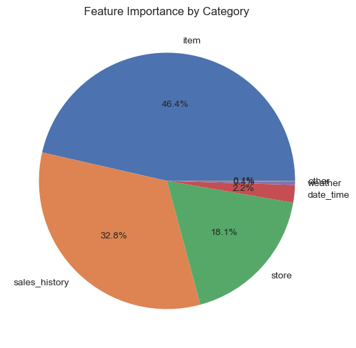
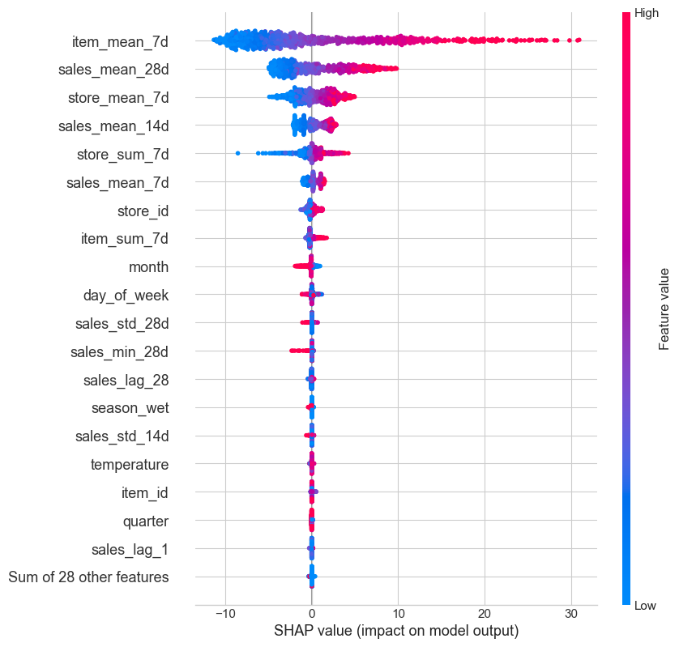
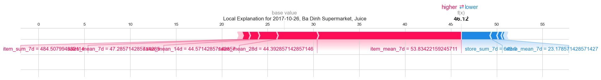
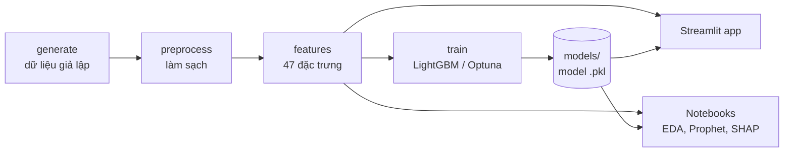

# 📈 Sales Forecasting with Explainable AI


Dự án dự báo **số lượng bán hằng ngày** của từng sản phẩm tại từng cửa hàng bằng **LightGBM**, đồng thời **giải thích** mỗi dự báo bằng **SHAP**. Kết quả được đóng gói trong một **ứng dụng Streamlit** để xem lại lịch sử bán hàng và thử các kịch bản dự báo.

> Đây là một Proof of Concept (PoC): chạy trên dữ liệu bán lẻ **giả lập** gồm 10 cửa hàng ở Hà Nội và TP.HCM, 35 sản phẩm, giai đoạn 2016–2017.

---

## ✨ Tính năng

- **Sinh dữ liệu giả lập**: doanh số chịu ảnh hưởng của cửa hàng, ngày trong tuần, mùa vụ, ngày lễ, thời tiết, tăng trưởng và nhiễu; có cố tình chèn giá trị thiếu và giá trị ngoại lai.
- **Làm sạch dữ liệu**: điền giá trị thiếu, xử lý ngoại lai bằng z-score, ghép dữ liệu thời tiết.
- **47 đặc trưng chuỗi thời gian**: lịch, thời tiết, lag, thống kê trượt, EWMA, đặc trưng tổng hợp theo cửa hàng/sản phẩm.
- **Mô hình**: Prophet làm mốc so sánh, LightGBM là mô hình chính, có thể tìm siêu tham số bằng Optuna. Dữ liệu được chia theo thời gian.
- **Giải thích bằng SHAP**:
  - mức độ quan trọng toàn cục, beeswarm, dependency plot;
  - giải thích từng dự báo riêng lẻ;
  - tổng hợp theo nhóm đặc trưng và theo thời gian.
- **Web app**:
  - dashboard lịch sử bán hàng;
  - công cụ dự báo what-if, kèm biểu đồ SHAP cho chính dự báo đang xem.
- **Chạy toàn bộ bằng một lệnh** và có **kiểm thử tự động** (pytest).

## 📊 Kết quả

Tập test là quý 4/2017 (10–12/2017), một giai đoạn sau toàn bộ dữ liệu train.

| Mô hình | MAE | WAPE |
|---|---|---|
| Prophet (mỗi chuỗi một mô hình) | 8.99 | 29.3% |
| **LightGBM** (một mô hình chung cho 275 chuỗi) | **7.66** | **25.0%** |
| LightGBM + Optuna | 8.18 | 26.7% |

*WAPE = tổng sai số tuyệt đối / tổng lượng bán thực tế.*

**Yếu tố ảnh hưởng nhiều nhất** theo SHAP: doanh số gần đây của sản phẩm, lịch sử bán của chính chuỗi đó, rồi đến cửa hàng. Lịch và thời tiết chỉ ảnh hưởng nhỏ.

<p align="center">
  
  
</p>

<p align="center">
  
</p>

> ⚠️ **Hạn chế đã biết.** Các đặc trưng `item_mean_7d` và `store_*_7d` hiện được tính trên doanh số **của chính ngày cần dự báo**, tức là bị rò rỉ dữ liệu (data leakage). Vì vậy điểm số và tỷ trọng SHAP của chúng đang cao hơn thực tế. Xem thêm ở mục [Hạn chế & hướng phát triển](#-hạn-chế--hướng-phát-triển).

---

## 🏗️ Kiến trúc



```
├── app.py                   # Streamlit entry point
├── src/
│   ├── config.py            # đường dẫn và hằng số (ngày test, ngưỡng, ngày lễ, tham số)
│   ├── pipeline.py          # CLI: generate → preprocess → features → train
│   ├── data/                # dữ liệu chủ, sinh dữ liệu, làm sạch, đọc/ghi file
│   ├── features/            # feature engineering
│   ├── modeling/            # metric, train/tune, Prophet, hàm hỗ trợ SHAP
│   ├── visualization/       # biểu đồ cho notebook và báo cáo
│   └── ui/                  # các trang Streamlit + logic dự báo
├── notebooks/               # 01 preprocessing → 05 explain (gọi lại code trong src/)
├── tests/                   # pytest: unit test + smoke test cho app
├── figures/                 # hình minh họa EDA & SHAP
├── requirements.txt
└── environment.yml          # môi trường conda (có environment_macm1.yml cho Mac M1)
```

Thư mục `data/` và `models/` được **tạo ra khi chạy pipeline** và không đưa lên repo.

---

## 🚀 Cài đặt

**Yêu cầu:** Python 3.11 (khuyến nghị), Git.

```bash
git clone <repo-url>
cd sales_forecasting_xai
```

**Cách 1: pip + virtualenv**

```bash
python -m venv .venv
# Windows
.venv\Scripts\activate
# macOS / Linux
source .venv/bin/activate

pip install -r requirements.txt
```

**Cách 2: conda**

```bash
conda env create -f environment.yml        # Mac M1: environment_macm1.yml
conda activate sales_forecast
```

> `prophet` chỉ cần cho phần baseline trong notebook 04 và đã có sẵn trong môi trường conda. Nếu dùng pip, cài thêm bằng `pip install prophet`.

## ▶️ Cách chạy

Mọi lệnh đều chạy từ **thư mục gốc** của dự án.

### 1. Tạo dữ liệu và huấn luyện mô hình

```bash
python -m src.pipeline
```

Lệnh này tạo `data/` (CSV và bảng đặc trưng dạng Feather) và `models/` (mô hình cùng file metadata), mất chưa tới 1 phút.

Các tùy chọn khác:

```bash
python -m src.pipeline --tune                      # dùng Optuna để tìm siêu tham số
python -m src.pipeline --steps features train      # chỉ chạy một số bước
```

### 2. Mở ứng dụng

```bash
streamlit run app.py
```

Ứng dụng mở ở <http://localhost:8501> và có 2 trang:

- **Historical Sales Analysis**:
  - lọc theo khoảng ngày, cửa hàng và danh mục;
  - xem KPI, xu hướng, doanh số theo ngày trong tuần, theo danh mục, theo cửa hàng.
- **Sales Prediction**:
  - chọn cửa hàng, sản phẩm, ngày, nhiệt độ, độ ẩm, ngày lễ để có **dự báo của mô hình**;
  - thêm các hệ số what-if (khuyến mãi, cạnh tranh, chuỗi cung ứng) để có **dự báo theo kịch bản**;
  - xem **biểu đồ SHAP** giải thích dự báo đó.

### 3. Xem các notebook (tùy chọn)

```bash
jupyter lab
```

Chạy lần lượt `01_preprocessing` → `02_EDA` → `03_feature_engineering` → `04_modelling` → `05_explain_model`.

### 4. Chạy kiểm thử

```bash
pytest
```

---

## ⚙️ Tùy chỉnh

| Muốn thay đổi | Sửa ở |
|---|---|
| Ngày bắt đầu tập test, ngưỡng nhiệt độ/độ ẩm, danh sách ngày lễ, tham số LightGBM | `src/config.py` |
| Cửa hàng, sản phẩm, khí hậu từng tỉnh | `src/data/catalog.py` |
| Quy luật sinh doanh số, tỷ lệ ngoại lai và giá trị thiếu | `src/data/generator.py` |
| Các hệ số what-if trong app | `src/ui/scenario.py` |

## 🧭 Hạn chế & hướng phát triển

- **Rò rỉ dữ liệu** ở `item_mean_7d` và `store_*_7d`. Cách sửa: tính tổng theo ngày, `shift(1)`, rồi lấy `rolling(7)`.
- Optuna hiện tune và early stopping trên tập test. Nên tách thêm một tập validation riêng.
- Bước điền giá trị thiếu và xử lý ngoại lai dùng thống kê của toàn bộ dữ liệu. Nên tính trên tập train và theo từng chuỗi.
- App chỉ dự báo được 1 ngày sau dữ liệu cuối. Muốn dự báo nhiều ngày cần dự báo đệ quy hoặc dùng mô hình riêng cho từng khoảng thời gian.
- Danh sách ngày lễ năm 2017 chưa đầy đủ, và các hệ số what-if mới là giả định, chưa học từ dữ liệu.

## 🛠️ Công nghệ

pandas · NumPy · LightGBM · Prophet · Optuna · scikit-learn · SHAP · matplotlib · seaborn · Streamlit · PyArrow · pytest

## 🙏 Ghi nhận

Dự án dựa trên PoC *Sales Forecasting with XAI* của **Nguyen Ha DS**, sau đó được refactor thành package `src/`, có pipeline chạy bằng một lệnh, có kiểm thử, và có giải thích SHAP cho từng dự báo trong app.
